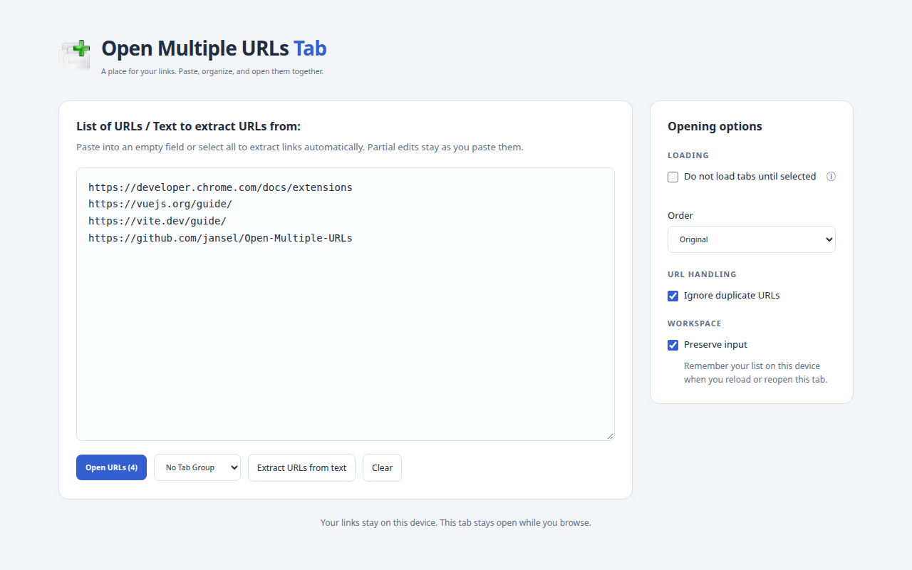

# Open Multiple URLs Tab

A Chrome/Chromium extension that opens lists of URLs from a persistent browser tab.
This is [Jason Ansel's independent fork](https://github.com/jansel/Open-Multiple-URLs) of
[htrinter/Open-Multiple-URLs](https://github.com/htrinter/Open-Multiple-URLs), based on upstream 1.7.5.
It has its own releases and is not intended to merge upstream.

Version **2.1.0** is submitted to the Chrome Web Store and **pending review**.



## What is different

- The toolbar button opens a full browser tab. Click again to return to the existing workspace in that window.
- Pasting into an empty input, or over all selected text, automatically extracts URLs. A partial selection or insertion leaves the pasted text unchanged. If no URLs are found, the original text is kept.
- The page stays open after opening URLs. Your input is remembered locally by default; turn off **Preserve input** to stop saving it between visits.
- **Ignore duplicate URLs** is enabled by default. Choose **Original**, **Reverse**, or **Random** from the **Order** dropdown.
- **Clear** empties the current list and its saved copy, ready for your next paste.
- A responsive layout supports light and dark themes.
- The toolchain and dependencies are updated, with unit tests and automated tests of the built extension in fresh Chromium profiles.

The upstream options for lazy loading, deduplication, random/reverse order, and Chrome tab groups are retained. Search-query handling and Firefox builds are no longer supported by this fork.

## Install

Version 2.1.0 was submitted to the [Chrome Web Store](https://chromewebstore.google.com/detail/legkeidpegglajidbdpiddmallhmfokj) on October 25, 2026, replacing the earlier 2.0.0 submission, and is **pending review**. It will publish automatically with **Unlisted** visibility after Google's approval. The upstream store listing installs a different extension.

For local installation:

1. Install Node 24.15 or newer in the Node 24 release line (`nvm install && nvm use`).
2. Run `npm ci` and `npm run build:chrome`.
3. Open `chrome://extensions`, enable **Developer mode**, choose **Load unpacked**, and select `dist-chrome`.
4. Pin **Open Multiple URLs Tab** in the browser's extensions menu.

Settings, tab-group choices, and saved input are local to each browser profile.

## Use

Click the toolbar icon, paste a list or text containing links, then click **Open URLs**. Each nonempty line becomes one tab; addresses without a scheme get `http://` added. Lines are never sent to a search provider by the extension.

Automatic extraction runs only on a paste that replaces the entire field (including an empty field). Use **Extract URLs from text** in the **Opening options** pane to extract manually. It is disabled when no URLs are found or extraction would leave the list unchanged. Extraction recognizes explicit schemes such as `https://`, `www.` addresses, and certain domain/path forms; plain bare domains or text with no recognizable links are kept as entered. If a paste mixes recognizable links with other text, only the extracted links remain.

**Do not load tabs until selected** opens placeholder tabs that navigate when selected. Browser-internal pages, file URLs, and active-content URLs cannot be deferred. **Ignore duplicate URLs**, enabled by default, compares input lines exactly. **Order** selects the original input order, its reverse, or a random order. Choose **Tab group** in the options pane. Tab groups are scoped to the current window and refreshed when the workspace regains focus.

## Development

```sh
nvm use
npm ci
npx playwright install chromium
npm run check:all
```

No system-wide package installation is needed on a machine with Chromium's runtime libraries. The CI workflow installs those libraries in its disposable runner.

| Command                               | Purpose                                                                      |
| ------------------------------------- | ---------------------------------------------------------------------------- |
| `npm run dev:chrome`                  | Rebuild on source changes; reload the unpacked extension in Chrome afterward |
| `npm run build:chrome`                | Type-check and build into `dist-chrome`                                      |
| `npm run check:all`                   | Type-check, lint, format check, unit tests, build, and Chromium tests        |
| `npm run test:unit`                   | Run unit tests with coverage and exit                                        |
| `npm run test:watch`                  | Watch unit tests during development                                          |
| `npm run test:e2e`                    | Test the existing build in fresh temporary Chromium profiles                 |
| `HEADED=1 npm run test:e2e`           | Show the Chromium test windows                                               |
| `npm run package:chrome`              | Build and create the store upload ZIP in `dist-package`                      |
| `npm run screenshots`                 | Capture light/dark store screenshots from the built extension                |
| `npm run lint:fix` / `npm run format` | Apply lint/format fixes                                                      |

Checks never modify source files. CI runs the complete check suite and uploads the Chrome ZIP as a build artifact. It does not publish to the store or push release tags. See [AGENTS.md](AGENTS.md) for short contributor instructions and [PUBLISHING.md](docs/PUBLISHING.md) for release steps and store listing copy.

## Permissions and privacy

- **storage** saves settings, input, and tab-group selection locally in the browser profile.
- **tabGroups** lists groups in the current window and places newly opened tabs into your chosen group.

The extension requests no website host permissions, browsing-history access, clipboard-reading permission, or search permission. It uses only the text you type or paste into its own page. There are no analytics, extension accounts, advertising, or remotely loaded code. See the [privacy policy](PRIVACY.md).

## Attribution and license

Based on **Open Multiple URLs** by [htrinter and contributors](https://github.com/htrinter/Open-Multiple-URLs). The original source history, icons, and GPL version 3 license are retained. This modified fork is distributed under the same [LICENSE](LICENSE). The earlier entries in [CHANGELOG.md](CHANGELOG.md) describe the upstream project.
